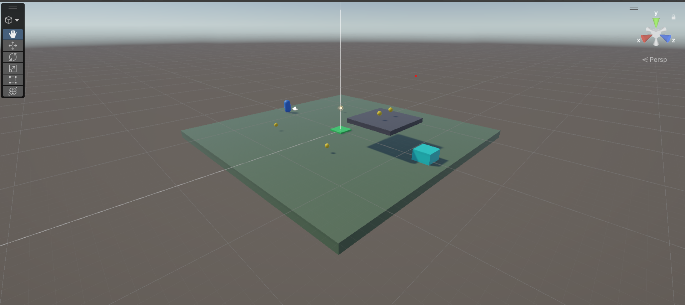
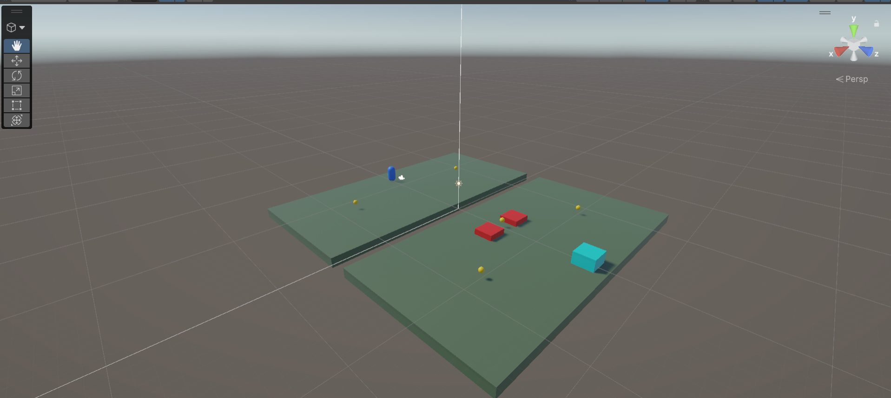
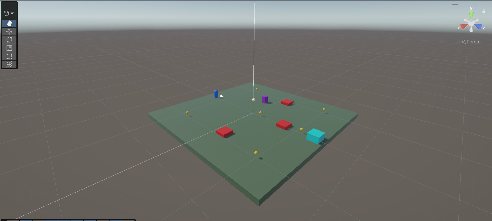
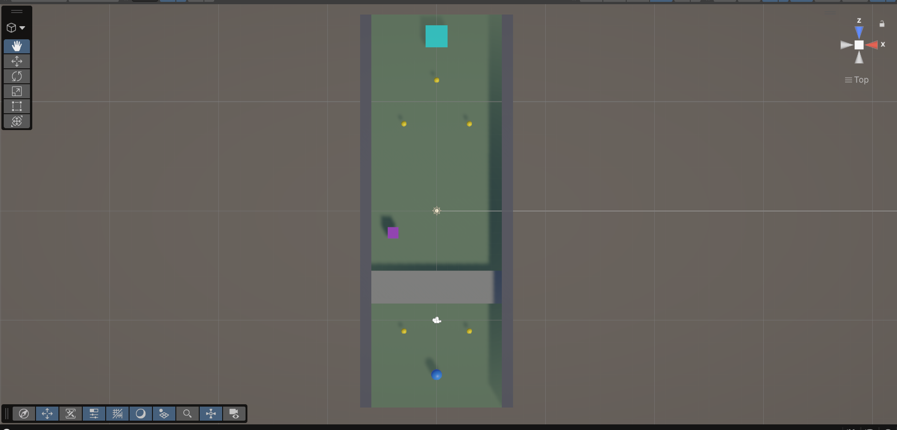
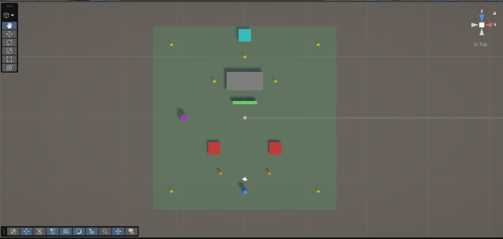

# CS464 Assignment 03 · BSCS24074

- **Video Link:** https://drive.google.com/file/d/1tcmnpAgkGFPXd4OMCxlj7s1tRlXwSfp5/view?usp=sharing
- **Started from:** A new project (Unity 6.3 LTS). I had no Assignment 02 repo to copy, so I started as Assignment 01's page 3 describes, with five scenes, a Rigidbody player and Active Input Handling set to Both.
- **Controls:** WASD or arrow keys to move, Space to jump.
- **To win a level:** Collect every coin in the level (Level01: 6, Level02: 5, Level03: 6, Level04: 5, Level05: 7). Reaching the goal with enough coins also wins. Lose all 3 lives (a fall costs one) and the game ends. Restart is on both the win and lose panels.

## Levels

| Level | Screenshot | New idea | Combined with |
|---|---|---|---|
| Level01 |  | Coins, a goal and the bounce pad | Nothing hurts yet |
| Level02 |  | Spikes, one heart at a time | A coin on a risky detour between two spikes, and a gap to jump |
| Level03 |  | A guard that patrols, chases, gives up and returns | Spikes beside its route |
| Level04 |  | The crusher, which warns before it strikes | A guard beside it, in a walled lane |
| Level05 |  | Two speed pickups, reachable within 5 s | Everything so far, a ping-pong guard and a checkpoint |

## The numbers

| Number | Value | Why this value |
|---|---|---|
| Patrol speed | 2 m/s | The player runs at 5 m/s, so a patrolling guard moves at 40% of my speed and is easy to read and avoid. |
| Chase range | 6 m (gives up beyond 10 m) | [Write what a guard can and can't see from its route in your levels.] The longer give-up range stops the guard flickering between states at one edge. |
| Chase speed | 3.5 m/s | Slower than my run speed (5 m/s), so a chase can always be escaped on open ground. |
| Knockback | 8, ForceMode.Impulse, steering paused 0.25 s | [Measure in play how far it throws you and write it here.] |
| I-frames | 1 s | [Write the time it takes you to get clear after a hit.] |
| Power-up duration | 5 s at 1.6x speed | [Write what 5 s is long enough for, and what it is not.] In Level05 the two pickups are 8 m apart, so both can be collected within 5 s. |
| Crusher warning | 0.7 s | Over the 0.5 s minimum, so there is time to react before the strike. |
| Bounce pad | 9, ForceMode.VelocityChange | [Write how high it throws you, measured in play.] |

## Short answers

**1. Why does a trigger need a Rigidbody on at least one of the two objects?**

Unity's physics engine only sends OnTriggerEnter/Stay/Exit for a pair of colliders when at least one of them has a Rigidbody. Two plain colliders with no Rigidbody are treated as static, so nothing fires and nothing reports why. In my game the player has a Rigidbody, so coins, spikes, the bounce pad, the goal and the kill zone work without one of their own. The guard moves by script, so it has a kinematic Rigidbody.

**2. Which ForceMode do your knockback and your Part A force use, and why each?**

Knockback uses `ForceMode.Impulse` (8): it is one kick when a hit lands, scaled by the player's mass, and my controller pauses steering for 0.25 s so the next move line doesn't wipe it. The Part A bounce pad uses `ForceMode.VelocityChange` (9), a one-off kick that ignores mass, called once from OnTriggerEnter after zeroing the vertical speed. That makes the bounce the same height every time, about 4 m.

**3. What does your code do when a second power-up is picked up while one is running?**

My rule is Refresh. `PlayerController.BoostSpeed` stops the running coroutine and starts a new one, so the speed boost does not stack, and the timer restarts at the full 5 s. Two pickups 3 s apart end at 8 s. The player runs the timer because the pickup is destroyed as soon as it is collected, which would cut off a timer running on it.

**4. Why can `==` fail as an arrival check, and when does it work?**

Positions are floats that move in steps, so a guard rarely lands on exactly the target value: it can stop just short or overshoot, and it ends up shivering around the point and never "arrives". `==` only works right after `Vector3.MoveTowards`, which snaps exactly onto the target when it is within one step. My `EnemyPatrol` uses `Arrived()` instead: it checks that the distance is under `arriveDistance` (0.1 m), which is bigger than one step at its speeds (about 0.07 m at chase speed).
