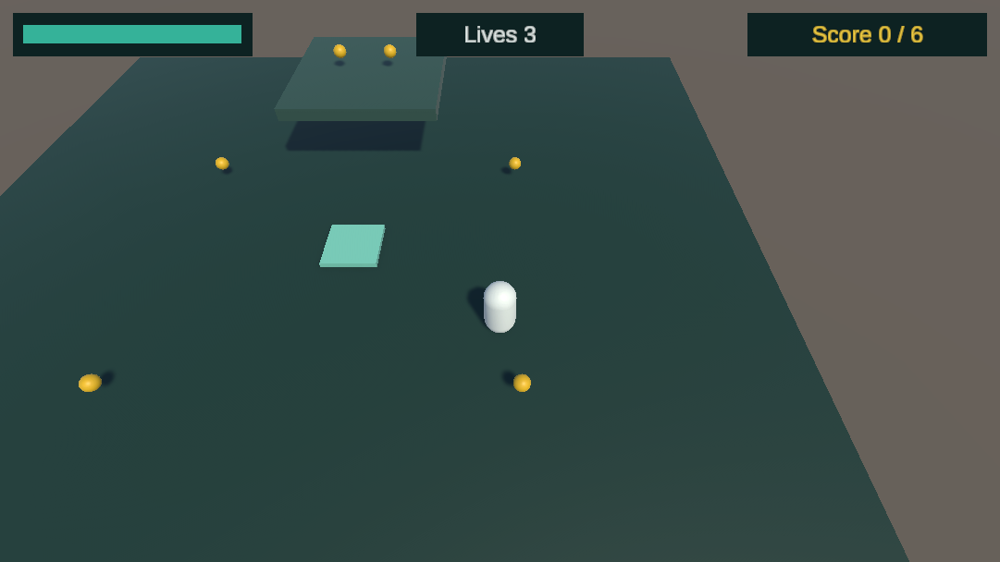
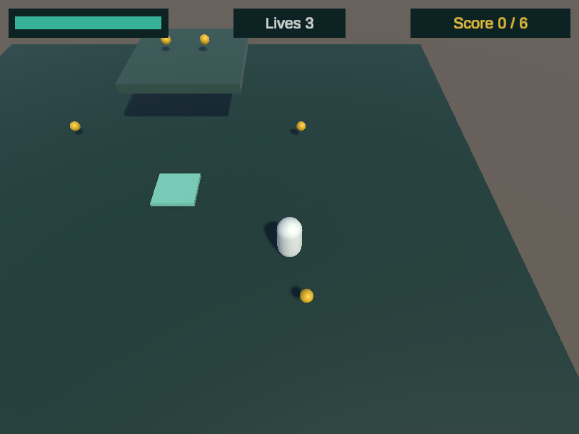
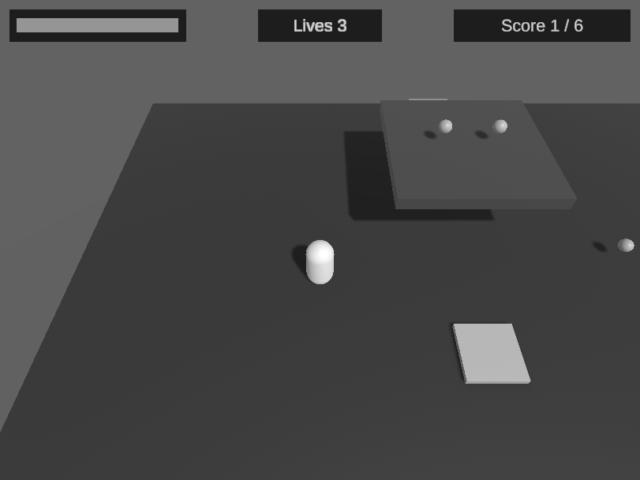
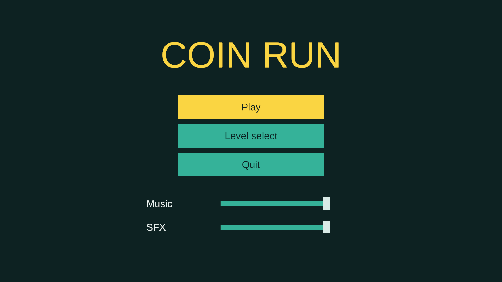
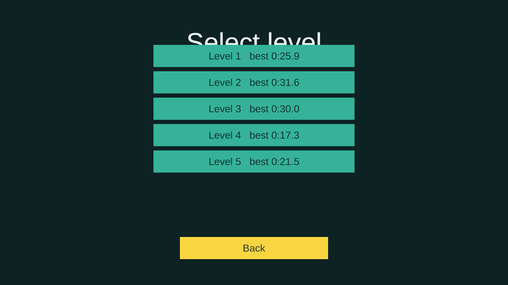
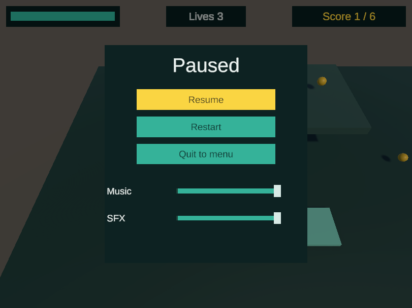
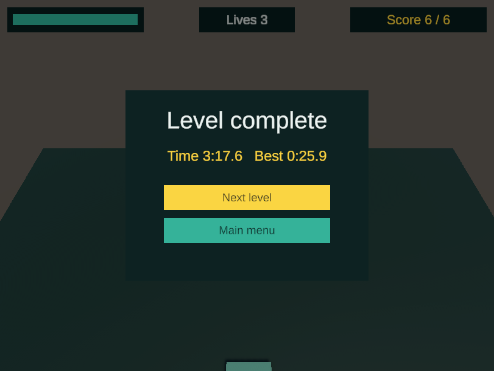
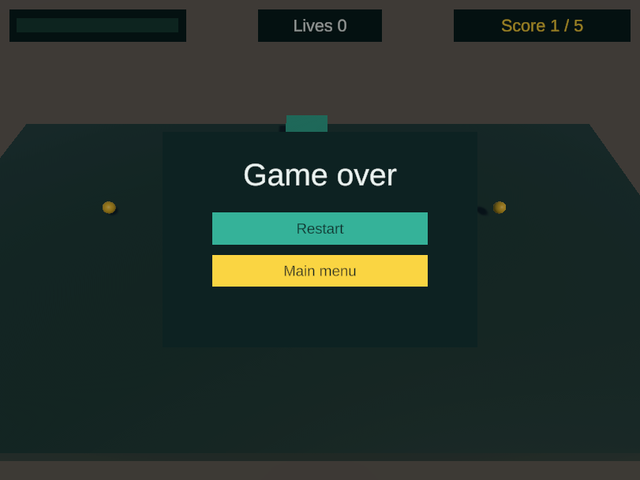

# CS464 Assignment 04 · Muhammad Aqib Ramzan · BSCS24074

**Video (90–180 s):** https://drive.google.com/file/d/1hS-q1CgayITd41ZCqtB1feZrm_Jt6x1J/view?usp=sharing

## Screenshots

| Main menu | Level select | Pause menu |
|---|---|---|
|  |  |  |

| Win screen | Game over |
|---|---|
|  |  |

- **Started from:** my Assignment 03 repo, copied with its history into this repo (Unity 6.3).
- **Controls:** WASD or arrows to move, Space to jump, Esc to pause. Every menu works with the arrow keys and Enter.

## Settings

| Part | Setting | Value | Why |
|---|---|---|---|
| A | Harmony · base hue | triadic · 168° | Teal base; the partners are 288° (pink-violet) and 48° (yellow). |
| A | Dark · mid · light | #0F2420 · #34B299 · #EBF4F2 | Gray 37 · 158 · 242, so the three values stay apart without colour. |
| A | Accents | #FAD542 · #E09DF1 | Score and selected buttons use the yellow; the pickup burst and damage flash use the pink. |
| A | Score text on its panel | 11.34 : 1 | #FAD542 on #0F2420. The lives and menu text (#EBF4F2) are 14.50 : 1. Both are on a solid panel, not the level. |
| A | Button label on the button | 6.16 : 1 | A dark #0F2420 label on #34B299. White would be 2.63 : 1, so it is dark. |
| B | Music · SFX groups, as mixed | 0 dB · 0 dB | At slider 1. The music is balanced by its AudioSource volume (0.45, about −6.9 dB) so effects sit above it. |
| B | Slider at 1 · 0.5 · 0.0001 | 0 dB · −6.02 dB · −80 dB | `Log10(v) × 20`. The slider's minimum is 0.0001 because Log10(0) is minus infinity. |
| C | Guard hum, in Level03–05 | Logarithmic · Min 2 m · Max 18 m | Min is about the guard's size. 18 m is longer than its 10 m give-up range, so you hear it coming before it chases you. |
| C | Goal beacon, in every level | Linear · Min 3 m · Max 30 m | Linear reaches silence at Max, so the beacon is only audible when the goal is in reach of the level, and it grows steadily as you head for it. |
| C | AudioListener | on the player (`ListenerOnPlayer`) | The follow camera sits 12 m up and 9 m back (about 15 m away), so on the camera every 3D sound would be far away. The camera's listener is removed. |
| D | unlocked | int · default 1 | Highest open level. Only Level 1 is open on a fresh machine. |
| D | best1 … best5 | float · HasKey first | A missing time is 0.0, which would beat every real time. |
| D | MusicVolume (and SfxVolume) | float · default 1 | Slider value 0.0001–1, applied to the mixer at Start. |

## Answers

1. **What `Time.timeScale = 0` stops in my game, and what it doesn't:** `Time.timeScale = 0` freezes everything on scaled time: physics and every `FixedUpdate` (player movement, the guards' patrol, the crusher's `WaitForSeconds` cycle), i-frames and the speed-boost timer. It does not stop `Update`, so `PauseMenu` still sees Esc, and `PlayerController.Update` has to check `PauseMenu.IsPaused`. It also doesn't stop the loading bar's `WaitForSecondsRealtime`, the health lag bar (unscaled time) or audio, hence `AudioListener.pause`.
2. **What survives a LoadScene in my game, and how:** The `SfxPlayer` and `MusicPlayer` objects survive, through `DontDestroyOnLoad` plus the singleton check in `Awake`, so a second copy destroys itself. PlayerPrefs survive on disk. `Time.timeScale`, `AudioListener.pause` and `PauseMenu.IsPaused` survive as static state, so `Resume()` runs before every load. The HUD, the `LevelLoader`, `GameManager` and the player are destroyed and made again each time.
3. **Why every PlayerPrefs read in my game has a default:** A key may not exist: on a fresh machine, or after Clear All PlayerPrefs. Without a default `GetInt("unlocked")` returns 0 and Level 1 would be locked, a missing `bestN` returns 0.0 so no real time could ever beat it, and a missing volume returns 0 and mutes the game. `SaveData` gives `unlocked` a default of 1 and volumes a default of 1, and checks `HasKey` before reading a best time.
4. **An exception a forgotten unsubscribe would throw, and why mine can't:** A forgotten `-=` leaves the delegate pointing at a destroyed object, so the next `Damaged?.Invoke` throws a `MissingReferenceException` ("the object of type HealthBar has been destroyed but you are still trying to access it"). Mine can't: every listener (`HealthBar`, `HitSound`, `HitSparks`, `DamageFlash`) subscribes in `OnEnable` and unsubscribes in `OnDisable`, which also runs when the scene unloads, and the events are on `Health`, which is rebuilt with the scene.
